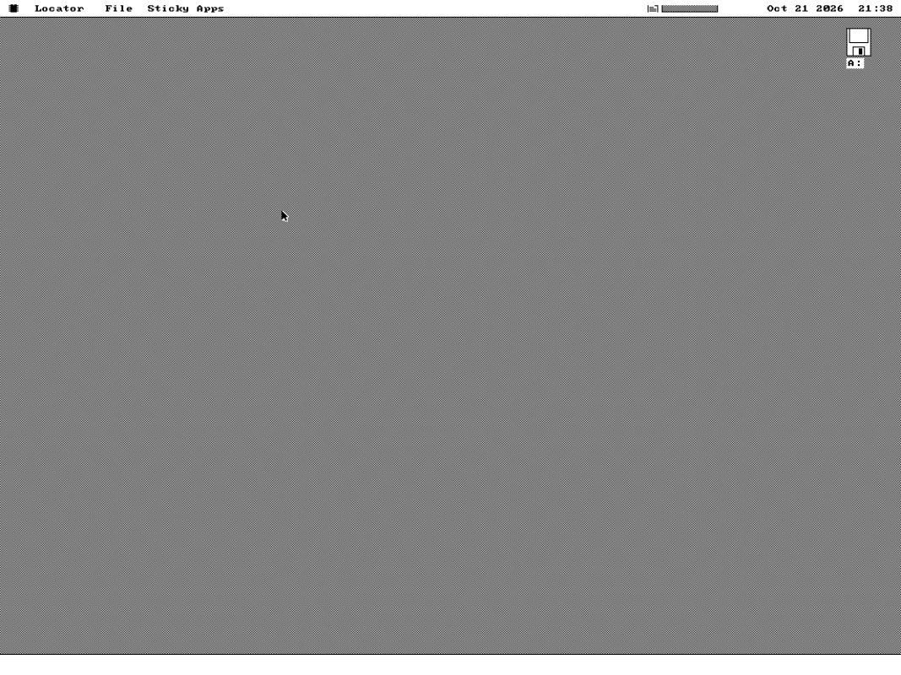

# The VBE 1024×768×16 effort, start to finish — a document set, 2026-10-21

Requested by the owner: run the fork's own VBE work up again, and write it
down as one account rather than leave it spread across SPEC.md §39.28/§39.29,
`docs/FIELD-MACHINES.md` and a run of commit messages. This is that account,
plus fresh evidence captured today.

**A correction this document starts with, because it ran through every prior
record of this work**: the Toshiba Satellite 4025CDT's video chip is a
**Chips & Technologies 65555**, not a NeoMagic. Every "NeoMagic" naming it
across `SPEC.md` §39.28/§39.29, `docs/FIELD-MACHINES.md`, `CONTINUE.md` and
three memory records has been corrected today, on the owner's word. Nothing
about the chip's *behaviour* as measured changes — every register, bank
boundary and readback figure below was taken from the real card under its
correct name, not re-derived — but any future reader cross-referencing a
C&T 65555 datasheet against this project's VBE notes was, until today,
looking for the wrong chip.

---

## 1. The question, and why it was askable at all

`SCREEN_W`/`SCREEN_H`/`ROW_BYTES` are this kernel's VGA mode-12h constants,
and the whole drawing stack reads the live `[vid_w]`/`[vid_h]`/`[vid_stride]`
instead (§39, CLAUDE.md's own hard rule). That split is *why* a fourth
geometry was even conceivable without a second renderer: a VBE mode that kept
the same 4bpp planar register contract (Set/Reset, the Bit Mask, the XOR ALU)
needed only a bigger stride and a bank, not a new drawing engine.

`0104h` (1024×768×16, planar) was chosen over a rounder or bigger number for
one arithmetic reason: at 128 bytes a row a plane, a 64KB VBE window holds
**exactly 512 rows**, so the bank boundary falls *between* rows rather than
through one. 800×600 (100 B/row) and 1280×1024 (160 B/row) both straddle a
boundary mid-row; on the Satellite, `0104h` was also the only bank-clean
planar mode the BIOS offered at all.

## 2. What was actually asked of real hardware, and what it answered

| date | instrument | asked | answered |
|---|---|---|---|
| 2026-10-03 | `tests/vbeprobe` | does the BIOS advertise `0104h`, and what does it claim about it? | yes — VBE 2.0, 2MB, `attr=001F` (bit 5 says VGA-compatible — the *opposite* of QEMU's `003B`), window A exists/writable/64KB/`A000`, 64KB granularity |
| 2026-10-03 | `tests/vbeset` | can the mode be SET and DRAWN in, with this kernel's own Set/Reset, Bit Mask and XOR ALU sequences? | yes — readback **13 of 13** (control arm 10/10), bank boundary measured at 66.6–67.4% of the picture against 66.7% predicted for row 512 of 768 |
| 2026-10-03/04 | `§39.28.2.4`'s palette readback (3C1h, not a photograph) | does `0104h` arrive with mode 12h's palette already loaded? | yes — entry 6 reads `AC 14 = 2A1500` (brown), exactly mode 12h's palette, on both the C&T 65555 and 86Box's Trident |
| 2026-10-04 | `VBE.DRV` stage 1, Satellite | does a real 1024×512 desktop (no banking yet) draw correctly? | yes — chrome, text, dock, drive icon, pointer all correct |
| 2026-10-05 | `VBE.DRV` stage 2, Satellite | does the full 768-row banked desktop draw correctly, round-trip a window drag across the boundary, survive a menu drop? | yes, after five field-found defects (below) — confirmed by the owner on the real machine |

QEMU answers none of this. Its Bochs BIOS advertises `0104h` with `003B`
(bit 5 clear — NOT VGA-compatible) and then does not map the window at
`A000` at all: `vbeset`'s raw probe reads `00 00 00 00` there against
`A5 A5 A5 A5` in mode 12h. That is stated in the BIOS's own attribute word, so
it is not a bug in the test — QEMU is a true negative control for this
feature and nothing more.

## 3. 86Box, and what it is and is not a substitute for

`make vbebox` (86Box, `gfxcard = tgui9440_vlb`, headless via Xvfb +
`QT_QPA_PLATFORM=xcb`, `xdotool ctrl+F11` for the card's own framebuffer
screenshot) is the **development** machine: `attr 001F`, VGA-compatible,
raw plane write `A5 A5 A5 A5`, readback 13/13, mode 12h's palette — matching
the Satellite's own numbers on every axis that is register-level and BIOS-
independent. It is what let stage 2's five defects (below) be found and fixed
in minutes instead of field round trips.

**What it does not answer, stated plainly and unchanged by today's
correction**: 86Box's card is a Trident, whose bank-select register sits at
3C4h index 0Eh. The Satellite's C&T 65555 is a different chip with its own
BIOS and its own register layout — SPEC.md never claimed otherwise, it named
the two chips and said the Satellite is the authority for anything touching
the card's own BIOS, which the correction leaves exactly as true as it was
written, just truthfully labelled now. §39.29.9.1/§39.29.9.2's cut-at-the-
boundary and bank-select mutation tests were both run and passed on 86Box;
they are necessary and not sufficient for that same reason, and the Satellite
is where the feature actually shipped against that standard.

## 4. The five defects stage 2 actually found, in order

Only the first two were anticipated by the design:

1. **Stride, not banking, broke first.** `ROW_BYTES` (80, a mode-12h literal)
   had to become `[vid_stride]`, and it has to be read `cs:`-relative — `DS`
   is `VGA_SEG` inside `vga_save_vram`/`vga_restore_vram`, the exact pair the
   cursor, every menu and every window share, so a plain DS read fetched
   pixels and used them as the row step.
2. **`vbe_bank` addressed its own state through DS** in three row loops that
   had already given DS away — a wild far call read out of video memory.
   Black screen.
3. **A primitive that walks its rect twice must re-home the window between
   walks** (six of them do), and the re-home must come BEFORE the `out dx,ax`
   that arms the plane select, or the BIOS call eats it.
4. **The fifth `[vid_kind]` table lived in the PACKAGE's segment** —
   `wm_pref_take` read 16 bytes past a 12-byte `OS88_PREFER` table and used
   executable bytes as a window size.
5. **The ghost was not banking at all** — a stale `vid_ctx` clamped every
   damage band to row 479 because display 0's context is never recaptured on
   a mode switch when there is one adapter, harmless until a mode exceeds the
   boot mode's height. The symptom (menu bar 512 rows down the panel) looked
   exactly like a bank defect and was not one.

The lesson stated plainly in the record and worth repeating here: **86Box's
Trident showed a clean 1024×768 desktop through every one of those five
builds, including the three where the Satellite's screen was wrong.** A
harness that passes is necessary and not sufficient — which is the whole
argument for owning a second, independent, real card rather than trusting one
emulator's model of one chip.

## 5. What it cost, measured per SPEC.md's own rule ("per-section bytes and
## the accrued figure, never 'crossed no rung'")

| | kern_big | kern_small |
|---|---|---|
| resident (row, dispatch, load pair, fifth `vid_tab` row, kind's arms) | `.text` +312, `.ovl` +12, `.cold` +0 — **no rung crossed** (accrued image 172/512 → 484/512) | **nothing** — it cannot load a `.DRV` at all (§51.0), the sniff and the row are `%ifdef OS88_DRIVERS` |
| per-row cost on mode 12h, the row EVERY machine pays | 2 bytes, one `jnc`, **measured 22 cycles taken** (PERFORMANCE.md Set 161) — 11–25% on a rect primitive, up to 24.8% on `GFX_VLINE 128px` | 0 |

That per-row cost is the reason §39.29.10 exists at all: the straddle-cut
redesign (§39.29.10.5) removed the per-row `jnc` from all 22 sites entirely,
replacing it with one cut-the-rect-at-the-boundary test per primitive — the
`gfx_disp_run` display-split shape already used for multi-monitor clipping,
applied to a bank boundary instead of a screen edge. `VBE.DRV` itself is a
`DRVC_OVL` cold half, `XMEM.DRV`'s shape: no `drv_tab` row, attach probes and
sets no mode, detach disarms a far pointer and an availability bit and has
nothing else to undo.

## 6. Fresh evidence, captured today

`make vbebox` was re-run against the current `forkmain` tree (build 603,
`kern_big`, image rung 275/512 = 53% accrued). It boots `build/vbeos.img`
straight into `VID_VBE` via a seeded `SYSTEM.CFG`, so no click is needed to
reach the mode:

Menu bar at the top across the full 1024px width, the floppy icon at its
correct corner, the dither pattern running unbroken top to bottom through the
row-512 bank boundary — the same picture §39.29.9.1's record describes,
reproduced on demand rather than quoted from memory.

## 7. What is still open

- **The Satellite's own BIOS-level confirmation of the straddle-cut and
  bank-select mutation tests** — both ran and passed on 86Box's Trident
  (§39.29.9.1/.2); the field machine is the harder case precisely because its
  bank register is not where Trident's is, and §39.29.8.2 has never claimed
  that gap closed.
- **Sustained-desktop cost on the C&T 65555 itself** — banking overhead and
  repaint time under real use, as opposed to the single-mode-switch and
  single-drag measurements taken so far.
- No further work is planned on this track beyond what the upstream PR
  comparison below recommends watching for.

See also: `docs/reports/VESA-PR295-REVIEW-2026-10-21.md`, a comment on the
`jggonz/os8088#295` draft's much broader VESA effort, read against what this
document records.
